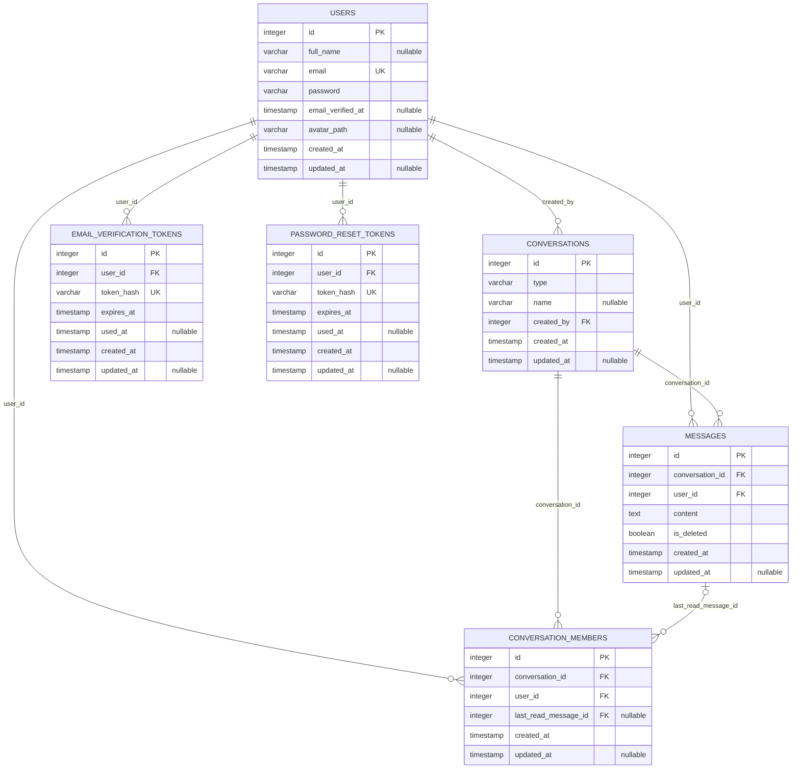

# Schéma de la base de données — Kadea Chat

Ce document décrit le schéma relationnel reconstitué à partir des migrations Lucid fournies dans `database/migrations`. Il faut le garder synchronisé avec les migrations réellement déployées.

## Diagramme relationnel



## Description des tables

### `users`

Stocke les comptes utilisateurs.

| Colonne | Rôle | Contrainte |
|---|---|---|
| `id` | Identifiant utilisateur | Clé primaire |
| `full_name` | Nom complet | Nullable |
| `email` | Adresse e-mail | Obligatoire, unique, longueur 254 |
| `password` | Mot de passe haché par l'application | Obligatoire |
| `email_verified_at` | Date de confirmation de l'e-mail | Nullable |
| `avatar_path` | Chemin ou référence de la photo de profil | Nullable |
| `created_at` | Date de création | Obligatoire |
| `updated_at` | Date de modification | Nullable |

### `conversations`

Représente une conversation privée ou de groupe.

| Colonne | Rôle | Contrainte |
|---|---|---|
| `id` | Identifiant de conversation | Clé primaire |
| `type` | Type de conversation | Obligatoire, varchar(20) |
| `name` | Nom de la conversation | Nullable |
| `created_by` | Utilisateur créateur | FK vers `users.id` |
| `created_at` | Date de création | Obligatoire |
| `updated_at` | Date de modification | Nullable |

### `conversation_members`

Table de liaison entre les utilisateurs et les conversations. Elle représente la relation plusieurs-à-plusieurs.

| Colonne | Rôle | Contrainte |
|---|---|---|
| `id` | Identifiant de l'association | Clé primaire |
| `conversation_id` | Conversation concernée | FK vers `conversations.id`, suppression en cascade |
| `user_id` | Utilisateur membre | FK vers `users.id`, suppression en cascade |
| `last_read_message_id` | Dernier message lu par ce membre | FK nullable vers `messages.id`, `SET NULL` à la suppression du message |
| `created_at` | Date d'ajout | Obligatoire |
| `updated_at` | Date de modification | Nullable |

Une contrainte unique sur (`conversation_id`, `user_id`) empêche d'ajouter deux fois le même utilisateur à une conversation.

### `messages`

Stocke les messages envoyés dans les conversations.

| Colonne | Rôle | Contrainte |
|---|---|---|
| `id` | Identifiant du message | Clé primaire |
| `conversation_id` | Conversation du message | FK vers `conversations.id`, suppression en cascade |
| `user_id` | Auteur du message | FK vers `users.id`, suppression en cascade |
| `content` | Contenu textuel | Obligatoire |
| `is_deleted` | Indique si le message est marqué comme supprimé | Booléen, défaut `false` |
| `created_at` | Date de création | Obligatoire |
| `updated_at` | Date de modification | Nullable |

Un index est défini sur `conversation_id` pour faciliter les recherches de messages par conversation.

### `email_verification_tokens`

Stocke les jetons utilisés pour confirmer les adresses e-mail.

| Colonne | Rôle | Contrainte |
|---|---|---|
| `id` | Identifiant du jeton | Clé primaire |
| `user_id` | Utilisateur concerné | FK vers `users.id`, suppression en cascade |
| `token_hash` | Empreinte du jeton | Obligatoire, unique, longueur 64 |
| `expires_at` | Date d'expiration | Obligatoire |
| `used_at` | Date d'utilisation | Nullable |
| `created_at` | Date de création | Obligatoire |
| `updated_at` | Date de modification | Nullable |

### `password_reset_tokens`

Stocke les jetons utilisés pour réinitialiser les mots de passe.

| Colonne | Rôle | Contrainte |
|---|---|---|
| `id` | Identifiant du jeton | Clé primaire |
| `user_id` | Utilisateur concerné | FK vers `users.id`, suppression en cascade |
| `token_hash` | Empreinte du jeton | Obligatoire, unique, longueur 64 |
| `expires_at` | Date d'expiration | Obligatoire, avec fuseau horaire |
| `used_at` | Date d'utilisation | Nullable, avec fuseau horaire |
| `created_at` | Date de création | Obligatoire, avec fuseau horaire |
| `updated_at` | Date de modification | Nullable, avec fuseau horaire |

Un index est défini sur `user_id`.

## Relations principales

- Un utilisateur peut créer plusieurs conversations ; chaque conversation référence son créateur.
- Un utilisateur peut appartenir à plusieurs conversations.
- Une conversation peut contenir plusieurs utilisateurs. La table `conversation_members` matérialise cette relation plusieurs-à-plusieurs.
- Un utilisateur peut envoyer plusieurs messages.
- Une conversation peut contenir plusieurs messages.
- Chaque message référence son auteur et sa conversation.
- Un membre peut référencer son dernier message lu ; cette référence est facultative.
- Un utilisateur peut posséder plusieurs jetons de confirmation et de réinitialisation.

## Règles référentielles importantes

- La suppression d'une conversation entraîne la suppression en cascade de ses membres et de ses messages, selon les contraintes déclarées dans les migrations.
- La suppression d'un utilisateur entraîne la suppression en cascade de ses membres, messages et jetons associés, selon les contraintes déclarées.
- La suppression d'un message référencé comme dernier message lu met `last_read_message_id` à `NULL`.
- L'association entre un utilisateur et une conversation est unique.

## Migrations

Les migrations sont dans `database/migrations`. Pour les appliquer dans un environnement configuré :

```bash
node ace migration:run
```

La table technique `adonis_schema` est utilisée par Lucid pour suivre l'exécution des migrations ; elle n'est pas une table métier de Kadea Chat.

## Note de cohérence

Ce diagramme décrit les colonnes et contraintes visibles dans les migrations fournies. Les comportements applicatifs (par exemple, la logique exacte de suppression d'une conversation de la liste d'un utilisateur) doivent être expliqués à partir des contrôleurs, services et modèles correspondants, et ne sont pas déductibles des seules migrations.
